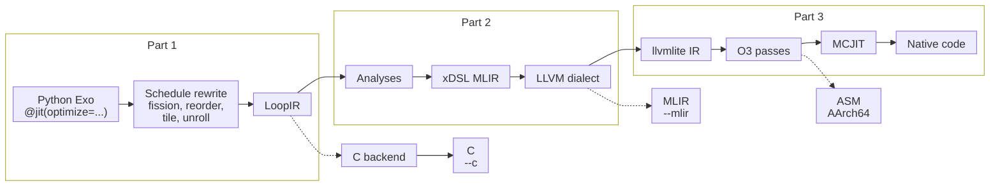

User-schedulable languages like the [Exo](https://github.com/exo-lang/exo)
Python-DSL let users write numerical kernels and declaratively optimize their
scheduling (e.g. loop unrolling).

So far, benchmarking any given schedule in the Python-DSL and invoking it in a
CPython runtime required several tedious steps.

This is because Exo's compiler emits C and header files, requiring separate
compilation, linking process and FFI calls or CPython extensions.

We introduce [exojit](https://github.com/sueszli/exojit), a just-in-time
compiler for Exo procedures that alleviates all these pain-points, by letting
users annotate their Exo functions with `@jit(optimize=...)` and invoke them
like regular Python functions.

The Exo compiler applies the schedule and verifies that invariances are held.
Then we translate Exo's LoopIR through xDSL to LLVM, use the MCJIT engine to
generate the binary and bind it with CFFI.



```python title="Part 1 - Exo source"
@proc
def add4(x: f32[4], y: f32[4]):
    for i in seq(0, 4):
        x[i] += y[i]
```

```c title="Part 1 - Simplified C output"
void add4(float *x, const float *y) {
    for (int i = 0; i < 4; i++) {
        x[i] += y[i];
    }
}
```

```mlir title="Part 2 - LLVM dialect"
llvm.func @add4(%x: !llvm.ptr, %y: !llvm.ptr) {
  %c0 = llvm.mlir.constant(0 : i64) : i64
  %c1 = llvm.mlir.constant(1 : i64) : i64
  %c4 = llvm.mlir.constant(4 : i64) : i64
  llvm.br ^loop(%c0 : i64)

^loop(%i: i64):
  %more = llvm.icmp "slt" %i, %c4 : i64
  llvm.cond_br %more, ^body, ^exit

^body:
  %xi = llvm.getelementptr %x[%i] : (!llvm.ptr, i64) -> !llvm.ptr, f32
  %yi = llvm.getelementptr %y[%i] : (!llvm.ptr, i64) -> !llvm.ptr, f32
  %vx = llvm.load %xi : !llvm.ptr -> f32
  %vy = llvm.load %yi : !llvm.ptr -> f32
  %sum = llvm.fadd %vx, %vy : f32
  llvm.store %sum, %xi : f32, !llvm.ptr
  %next = llvm.add %i, %c1 : i64
  llvm.br ^loop(%next : i64)

^exit:
  llvm.return
}
```

```asm title="Part 3 - AArch64 assembly"
_add4:
    ldr     q0, [x1]
    ldr     q1, [x0]
    fadd.4s v0, v1, v0  ; SIMD optimization
    str     q0, [x0]
    ret
```

Users can now write, schedule, execute, benchmark and verify a kernel all in the
same Python script, making experimentation with Exo a lot more pleasant to
integrate into their existing workflow and opening up the door to faster
iteration cycles for humans, LLMs and auto-schedulers.

The following `@jit` example tiles a 32×32 matrix multiply and stages the
output in one reusable 2×32 stack buffer. The innermost loop updates
contiguous columns so LLVM can vectorize it:

```python
# /// script
# requires-python = "==3.14.*"
# dependencies = ["exojit @ git+https://github.com/sueszli/exojit"]
# ///

import math
import random

from exo import *
from exo.API import Procedure
from exo.libs.memories import DRAM_STACK
from exo.stdlib.scheduling import divide_loop, fission, lift_alloc, reorder_loops, set_memory, simplify, stage_mem

from exojit import jit


# The schedule transforms the 32×32 matmul into:
#
# acc = empty((2, 32), dtype=float32)  # one reusable stack tile
# for i in range(0, 32, 2):
#     acc[:, :] = 0.0
#     for k in range(32):
#         for ii in range(2):
#             for j in range(32):
#                 acc[ii, j] += A[i + ii, k] * B[k, j]
#     out[i:i + 2, :] = acc
def optimize_matmul(p: Procedure) -> Procedure:
    # found through llm autoresearch
    p = divide_loop(p, "j", 32, ["jo", "ji"], perfect=True)
    p = reorder_loops(p, "i jo")
    p = divide_loop(p, "i", 2, ["io", "ii"], perfect=True)
    p = stage_mem(p, p.find_loop("ii").as_block(), "out[2*io:2*io+2, 32*jo:32*jo+32]", "acc")
    p = fission(p, p.find_loop("k").before(), n_lifts=2)
    p = reorder_loops(p, "ji k")
    p = reorder_loops(p, "ii k")
    p = lift_alloc(simplify(p), "acc", n_lifts=2)
    return set_memory(p, "acc", DRAM_STACK)


@jit(optimize=optimize_matmul)
def matmul(
    out: f32[32, 32] @ DRAM,
    A: f32[32, 32] @ DRAM,
    B: f32[32, 32] @ DRAM,
):
    for i in seq(0, 32):
        for j in seq(0, 32):
            out[i, j] = 0.0
            for k in seq(0, 32):
                out[i, j] += A[i, k] * B[k, j]


def test_matmul():
    A = [[random.uniform(-1.0, 1.0) for _ in range(32)] for _ in range(32)]
    B = [[random.uniform(-1.0, 1.0) for _ in range(32)] for _ in range(32)]
    out = [[0.0] * 32 for _ in range(32)]
    expected = [[sum(A[i][k] * B[k][j] for k in range(32)) for j in range(32)] for i in range(32)]

    matmul(out, A, B)
    assert all(math.isclose(out[i][j], expected[i][j], rel_tol=1e-5, abs_tol=1e-5) for i in range(32) for j in range(32))


if __name__ == "__main__":
    test_matmul()
```
